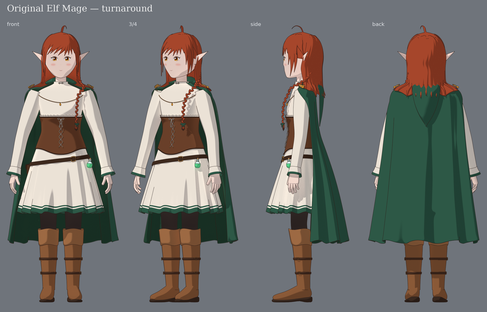
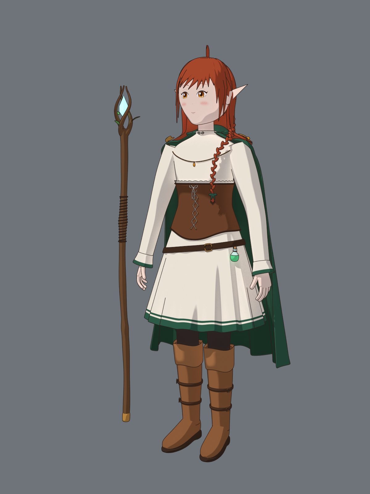
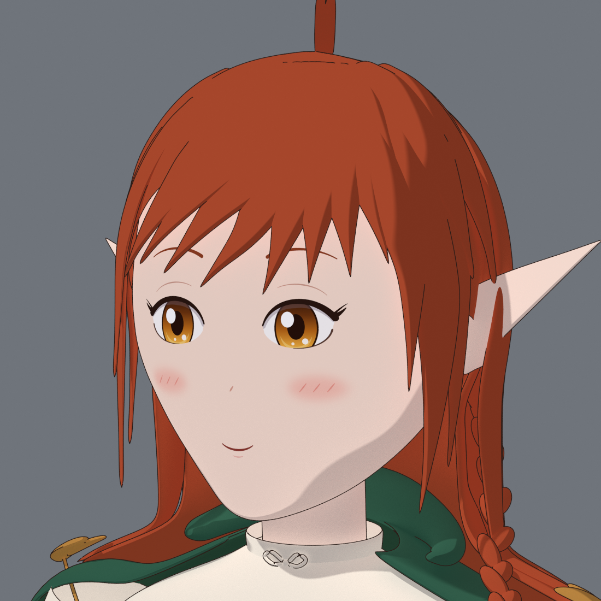

# Эльфийка-маг — оригинальный персонаж (3D)

Процедурная 3D-модель оригинальной эльфийки-травницы в аниме-стиле: медно-рыжие волосы с косой,
янтарные глаза, зелёный плащ с опущенным капюшоном, кремовое платье с кожаным корсетом, пояс с
сумкой и флаконом, высокие сапоги с ремешками и деревянный посох с кристаллом. Вся геометрия
генерируется кодом в Blender 5.0 (`bpy`).



| Общий вид | Лицо |
|---|---|
|  |  |

## Файлы

| Файл | Что внутри |
|---|---|
| `model/elf_mage.glb` | основная модель: ≈541 тыс. треугольников, 57 мешей, 26 материалов, текстура лица встроена |
| `model/elf_mage_lite.glb`, `model/elf_mage_lite.fbx` | облегчённая версия (≈153 тыс. треугольников) для игровых движков |
| `model/elf_mage.blend` | сцена Blender с живыми модификаторами (Subdivision, Solidify); коллекции Body, Hair, Outfit, Accessories, Staff |
| `model/textures/face.png` | текстура лица (глаза, брови, рот, румянец) |
| `renders/` | cel-shaded рендеры: Cycles, Toon BSDF и контуры Freestyle |

Рост ≈1,56 м с хохолком, единицы — метры, A-поза. В Blender персонаж смотрит в −Y, в glTF — в +Z
(стандартное направление «вперёд»). Посох — отдельный объект `Staff_Root`.

## Как пересобрать

```bash
uv venv /opt/bpy-venv --python 3.11
uv pip install --python /opt/bpy-venv/bin/python bpy==5.0.1 pillow numpy
/opt/bpy-venv/bin/python elf-mage/scripts/make.py --export --render final
/opt/bpy-venv/bin/python elf-mage/scripts/check_glb.py elf-mage/model/elf_mage.glb
```

`--render preview` даёт быстрые превью. `--views` и `--extras` выбирают ракурсы: доступны
`hero`, `face`, `hand`, `boots`, `back_head`, `face_front`.

## Устройство

- `scripts/character.py` — тело из суперэллипсных профилей, одежда, волосы (пряди и объёмная
  оболочка), коса, посох.
- `scripts/face_texture.py` — рисует черты лица (PIL) в координатах головы; голова получает
  планарную UV-проекцию и сглаженные нормали лица.
- `scripts/geom.py` — кривые, лофтинг и коллайдеры, благодаря которым плащ, волосы и коса не
  проходят сквозь тело.
- `scripts/render.py` — тун-шейдинг, контуры, отдельный «лицевой» свет без теней от волос,
  сборка листа поворотов.

## Ограничения

- Скелета (рига) нет: модель статична в A-позе.
- Мультяшный вид (контуры, ступенчатые тени) даёт рендерер из `render.py`. В GLB/FBX —
  обычные PBR-материалы с плоскими цветами.
